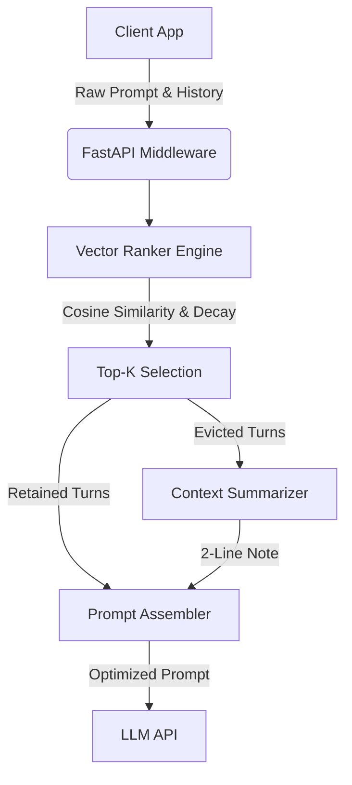

# TokenFlow AI

> **Outcome:** A stateless middleware layer that compresses large LLM prompt histories by isolating critical turns and generating a background memory note, saving API costs and reducing context window bloat.

[](https://github.com/NaniToka/TokenFlow-AI/actions)
[](#)

## ⚡ The Problem
Modern conversational AI workflows suffer from a compounding engineering challenge: **re-sending full uncompressed chat histories on every turn scales input tokens quadratically**. This inflates API costs, degrades Time-To-First-Token (TTFT), and risks context window exhaustion without adding meaningful signal.

## 📊 Benchmark Results

| Metric | Result |
| :--- | :--- |
| **Token Reduction** | 40.27% |
| **Answer Quality Retained** | ~95.97% |
| **Original Tokens** | 370 |
| **Compressed Tokens** | 221 |

> **Conditions**: Sample size of 2 synthetic multi-turn conversations (DevOps debugging and Python DB scripting). Baseline was sending full raw conversation history. Evaluated locally using fallback lexical similarity (Jaccard) and extractive summaries. See `benchmarks/run.py` to reproduce.

## 📐 Architecture



## 🛠️ Key Design Decisions

1. **Stateless API Design over Stateful Database**
   * **Why**: Avoids GDPR/HIPAA compliance risks associated with storing user prompts and PII in a database.
   * **Trade-off**: Requires the client to send the full history to the middleware on every request, creating network overhead, though it solves the LLM context limit problem.
2. **Hybrid Recency & Semantic Ranking**
   * **Why**: Relying purely on semantic similarity can surface mathematically similar but functionally obsolete turns. Adding exponential decay ensures recent context is prioritized.
   * **Trade-off**: Requires tuning the `alpha` parameter for different domains; a static decay curve might overly penalize long, single-topic conversations.
3. **In-Memory Token Counting vs Server-Side Estimation**
   * **Why**: Uses `tiktoken` locally to pre-calculate the exact token delta before and after compression to guarantee cost savings.
   * **Trade-off**: Increases middleware CPU utilization and latency slightly (~5ms) compared to rough character-based approximations.

## 🚀 Quickstart

```bash
git clone https://github.com/NaniToka/TokenFlow-AI.git
cd TokenFlow-AI
cp backend/.env.example backend/.env
docker compose up -d
curl http://localhost:8000/api/v1/health
```

## 📖 Documentation & Links
* [API Documentation Reference](http://localhost:8000/docs)
* [Engineering Notes (Cost & Latency)](docs/ENGINEERING_NOTES.md)
* [Contributing Guidelines](CONTRIBUTING.md)

## ⚠️ Known Limitations
* The fallback extractive summarization (when no Gemini key is provided) is primitive and heavily favors the user's recent input.
* Requires manual tuning of the `top_k` and `recency_weight` parameters depending on the LLM application domain.
* Synchronous API endpoints can block if the external LLM API (for summarization) is slow; no async worker pool yet.

## 🗺️ Roadmap
* [ ] Migrate summarization to asynchronous workers to avoid blocking the main FastAPI thread.
* [ ] Add dynamic `alpha` tuning based on conversational drift detection.
* [ ] Implement Redis-backed caching for embedding vectors to skip re-calculating similar turns.
