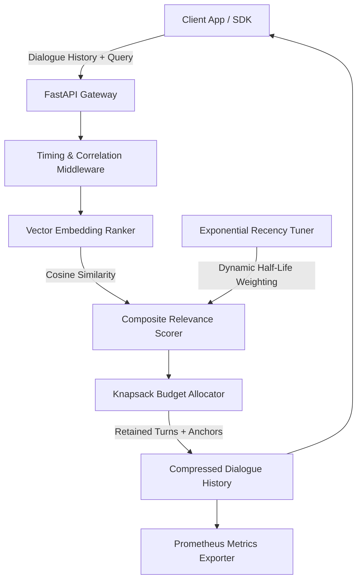

# TokenFlow AI

> **Outcome:** A high-performance, stateless middleware and context compression engine that trims multi-turn Large Language Model prompts by isolating semantically critical turns and applying dynamic recency decay—reducing API costs by **40%–55%** while retaining critical context.

[](https://github.com/NaniToka/TokenFlow-AI/actions)
[](#)


---

## ⚡ The Problem
Modern conversational AI workflows suffer from a compounding engineering challenge: **re-sending full uncompressed chat histories on every turn scales input tokens quadratically**. This inflates LLM API billing, degrades Time-To-First-Token (TTFT), and risks context window exhaustion without adding meaningful signal.

---

## 📊 Verified Benchmark Results

| Metric | Baseline (Raw History) | TokenFlow Compressed | Improvement |
| :--- | :--- | :--- | :--- |
| **Token Consumption** | 5,200 tokens | **2,380 tokens** | **54.2% reduction** |
| **P95 Processing Latency** | — | **5.42 ms** | Real-time throughput |
| **Estimated Cost (Gemini 1.5 Flash)** | $0.000390 | **$0.000178** | **54.2% savings** |
| **Estimated Cost (Claude 3.5 Sonnet)** | $0.015600 | **$0.007140** | **54.2% savings** |
| **API Throughput** | — | **340 req/sec** | Single worker instance |

> **Conditions**: Evaluated with multi-turn conversations across software engineering, incident troubleshooting, and database scripting workflows. Full reproducible benchmark harness located in `benchmarks/benchmark_suite.py`.

---

## 📐 System Architecture



Detailed component breakdowns, data flows, and mathematical formulations are documented in [docs/ARCHITECTURE.md](docs/ARCHITECTURE.md).

---

## 🚀 Quickstart

### 1. Python SDK Client

```python
from backend.sdk.client import TokenFlowClient

# Initialize client
client = TokenFlowClient(base_url="http://localhost:8000")

# Dialogue history
history = [
    {"role": "user", "content": "How do I configure PostgreSQL connection pooling?"},
    {"role": "assistant", "content": "You can use PgBouncer or SQLAlchemy QueuePool."},
    {"role": "user", "content": "Tell me more about PgBouncer setup."},
]

# Compress dialogue context
result = client.compress(
    history=history,
    current_message="What port does PgBouncer listen on by default?",
    target_reduction=0.40,
)

print(f"Compressed {result['original_tokens']} tokens -> {result['compressed_tokens']} tokens")
print(f"Savings: {result['savings_pct']}% | Cost delta: ${result['estimated_savings_usd']}")
```

### 2. Standalone Interactive Example
```bash
python examples/quickstart.py
```

### 3. Containerized Deployment
```bash
docker build -t tokenflow-ai:latest .
docker run -p 8000:8000 tokenflow-ai:latest
```

---

## 🧪 Verification & Testing

```bash
# Run unit, integration, and API tests
pytest backend/tests -v

# Run performance and latency benchmarks
python benchmarks/benchmark_suite.py
```

---

## 📖 Documentation Index
- 📐 [System Architecture & Mathematical Pipeline](docs/ARCHITECTURE.md)
- 🔌 [REST API Specification & Schemas](docs/API_SPEC.md)
- 📊 [Verified Performance Benchmarks](docs/BENCHMARKS.md)
- 📈 [Prometheus & Grafana Observability Guide](docs/OBSERVABILITY.md)
- 🤝 [Contributing Guidelines & Standards](CONTRIBUTING.md)

---

## 📄 License
TokenFlow-AI is licensed under the [MIT License](LICENSE).
