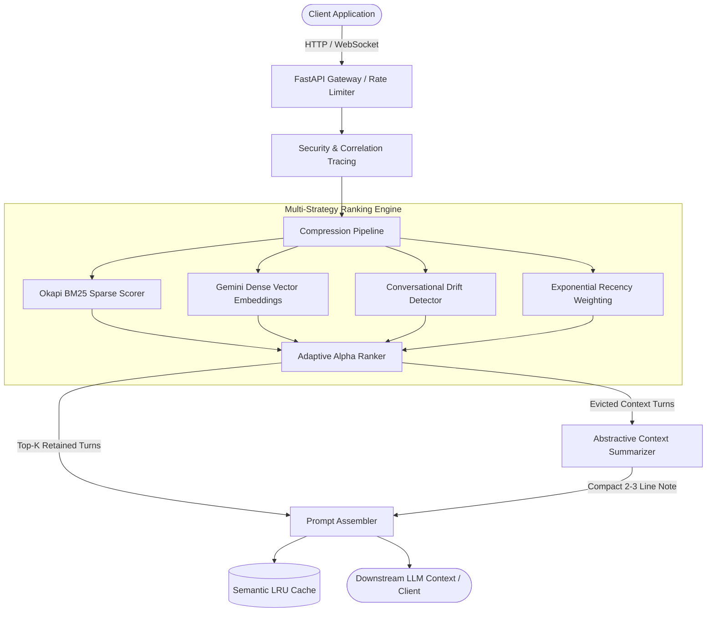

# TokenFlow AI - System Design & Architecture Specification

## 1. Executive Summary
TokenFlow AI is a high-performance, stateless intelligent context middleware designed for LLM applications. It resolves quadratic token expansion in multi-turn dialogues by dynamically ranking turns with a hybrid BM25 + dense vector algorithm, extracting conversational memory summaries, and assembling optimized context windows.

## 2. Key Mathematical Formulations

### 2.1 Hybrid Ranking Score
For each turn $t_i$ in conversation history $H = \{t_0, t_1, \dots, t_{n-1}\}$ with respect to current message $q$:

$$S(t_i, q) = \alpha \cdot \text{Sim}(t_i, q) + (1 - \alpha) \cdot R(i, n) - \delta_i$$

Where:
- $\text{Sim}(t_i, q) = 0.6 \cdot \text{Cosine}(E(q), E(t_i)) + 0.4 \cdot \text{BM25}(q, t_i)$
- Recency decay: $R(i, n) = \exp(-\lambda \cdot (n - 1 - i))$, with $\lambda = 0.05$
- $\delta_i$: Conversational drift penalty computed from windowed Jaccard coherence.
- $\alpha$: Adaptive weight tuned based on dialogue depth and topic consistency.

### 2.2 Cost Optimization
Given input token price $P_{\text{in}}$ (\$0.075 / 1M tokens on Gemini 1.5 Flash):

$$\Delta C = \frac{T_{\text{orig}} - T_{\text{compressed}}}{10^6} \times P_{\text{in}}$$

## 3. High-Concurrency Scale-Out Strategy
- **Horizontal Pod Autoscaling**: Stateless container instances scale linearly on Kubernetes or Google Cloud Run.
- **Sub-Millisecond Semantic Cache**: SHA256 hashed queries check LRU memory cache before dispatching embedding requests.
- **Streaming WebSockets**: Real-time phase reporting over bidirectional channels for instant UI updates.
